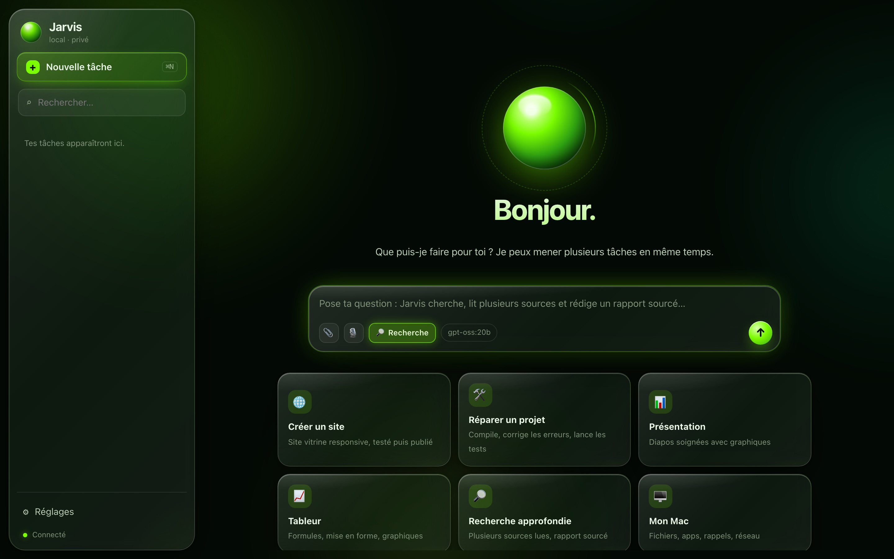
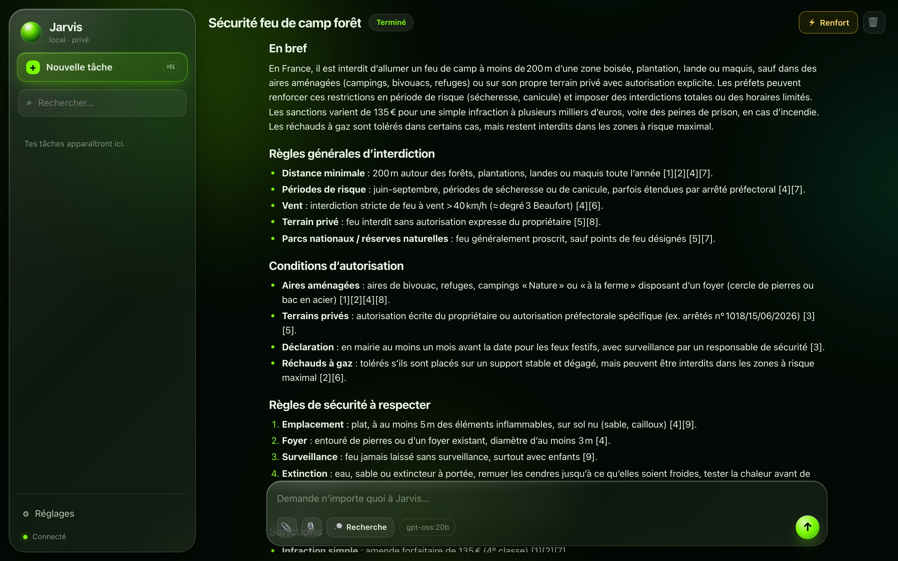
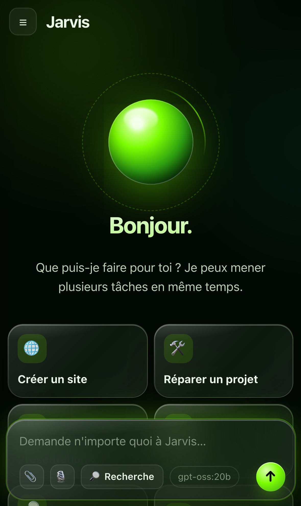
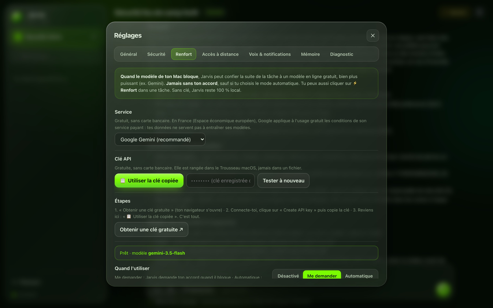

# Jarvis — agent IA local, gratuit et sécurisé pour Mac (et iPhone)

> Un assistant façon ChatGPT / Claude qui tourne **entièrement sur un MacBook Air M5** : 0 € d'abonnement,
> tes fichiers restent chez toi. Il ne fait pas que répondre : il **agit** (code, Office, sites, Git, Calendrier…)
> et **vérifie son propre travail**.

<p align="center"></p>

- 🧠 **Agent autonome** : planifie, appelle 63 outils, mène plusieurs tâches en parallèle, se relit avant de rendre.
- ⚡ **Rapide en local** : gpt-oss-20b sur MLX d'Apple, première action en 2 à 6 s (outils filtrés + cache préchauffé).
- 🔎 **Recherche approfondie** : recherches en parallèle, lecture des pages, rapport sourcé.
- 🎨 **Images créées sur le Mac**, 📅 Calendrier et Rappels, 🗂 recherche par le sens dans tes fichiers.
- 📱 **iPhone** : app sur l'écran d'accueil, notifications chiffrées de bout en bout, Siri et bouton Action.
- 🛡 **Sécurité** : bac à sable macOS, clés dans le Trousseau, défense contre l'injection de prompt, journal d'audit.
- ☁️ **Renfort gratuit facultatif** (Gemini, relais Mistral, modèle privé d'Apple) quand le modèle local bloque, avec ton accord.

**Technique** : Python (FastAPI, asyncio, threads), Swift (AppKit, WebKit, EventKit, Carbon), JavaScript sans
framework, MLX / Ollama, Playwright, Web Push (RFC 8291/8292), Tailscale. ~14 000 lignes, 260+ tests.
👉 **[Comment ça marche : docs/ARCHITECTURE.md](docs/ARCHITECTURE.md)**

<p align="center">
  
  
</p>
<p align="center">
  
  
</p>

## Installation

**Depuis GitHub** (Mac Apple Silicon, 16 Go de RAM ou plus ; 24 Go conseillés) :

```bash
git clone https://github.com/raphaelflipo/jarvis.git
cd jarvis && bash install.sh
```

**Ou avec l'app d'installation** (`bash packaging/build.sh` fabrique `dist/Jarvis-v3.1.zip`) :

1. Décompresse `Jarvis-v3.1.zip` (double-clic), puis double-clique sur **Installer Jarvis**.
2. **Première ouverture seulement.** macOS bloque les apps qui ne viennent pas de l'App Store. Il affiche « Apple n'a pas pu vérifier… » :
   - clique sur **OK** ;
   - va dans **Réglages Système › Confidentialité et sécurité** ;
   - tout en bas, clique sur **Ouvrir quand même** à côté de « Installer Jarvis » ;
   - saisis ton mot de passe.
   
   Ce blocage s'explique ainsi : signer une app chez Apple coûte 99 $/an, ce qui est contraire à la règle « 0 € ».

3. Clique sur **Installer**. Le Terminal s'ouvre et montre la progression (20 à 45 min). Réponds aux quelques questions :
   - ton mot de passe de session, pour Homebrew ;
   - **o** pour connecter GitHub et Firebase ;
   - **o** pour Tailscale (accès depuis l'iPhone) ;
   - **o** pour ajouter Jarvis au Dock ;
   - **o** pour autoriser tes dossiers de projets.
4. À la fin, Jarvis s'ouvre tout seul. Pour la souris et les captures d'écran, autorise **Jarvis** dans :
   - **Réglages Système › Confidentialité et sécurité › Accessibilité** ;
   - **Réglages Système › Confidentialité et sécurité › Enregistrement de l'écran**.

**Si le double-clic ne marche pas**, ouvre le Terminal et lance :
`bash ~/Downloads/Jarvis-v3.1/"Installer Jarvis.app"/Contents/Resources/payload/install.sh`

**Mise à jour :** relance l'installateur (5 minutes environ : les modèles déjà téléchargés ne sont pas re-téléchargés). Ta config, ta mémoire et ton historique sont conservés.

## Envoyer des fichiers à Jarvis

Trois façons de joindre des fichiers (jusqu'à 4 Go chacun) :
- **📎** dans la zone de message ;
- **glisser-déposer** depuis le Finder ;
- **coller** (⌘V) une image ou une capture.

Les fichiers sont rangés dans `~/JarvisWorkspace/Fichiers reçus/`. Jarvis les lit avant de répondre.

| Format | Ce que Jarvis en tire |
|---|---|
| PDF | Texte page par page ; **OCR automatique** des PDF scannés |
| Word (.docx .doc .rtf .odt), Pages | Texte, titres, tableaux |
| Excel (.xlsx .xls .csv), Numbers | Feuilles, valeurs, formules |
| PowerPoint (.pptx), Keynote | Texte, notes, données des graphiques, aperçu visuel |
| Images (JPG, PNG, HEIC, WebP, TIFF…) | OCR + description visuelle (modèle vision) |
| Pixelmator (.pxd), Photoshop (.psd), Affinity, Sketch, Illustrator | Aperçu Quick Look + OCR + description visuelle |
| Exports Canva (PDF, PNG, JPG, PPTX, MP4) | Comme les formats ci-dessus |
| E-mails (.eml), archives (.zip), code, texte | Contenu complet |

Jarvis peut aussi **convertir** des fichiers. Par exemple :
- `.pxd` → PNG ;
- PDF → images ;
- Keynote ↔ PowerPoint, Pages ↔ Word, Numbers ↔ Excel ;
- tout document → PDF (via Keynote/Pages/Numbers, gratuits).

Le contenu des pièces jointes est traité comme une *donnée externe* : Jarvis n'obéit jamais à des instructions cachées dedans.

## Ce qu'il y a dedans

| Brique | Outil gratuit / open-source | Rôle |
|---|---|---|
| Cerveau | **Ollama** + modèle choisi selon ta RAM : **qwen3:8b** (16 Go), **gpt-oss:20b** + **qwen3:14b** (24 Go), **qwen3-coder:30b** (32 Go et plus) | Raisonnement, code, appel d'outils |
| Renfort (facultatif) | **Gemini**, **Mistral**, OpenRouter ou Groq, offres gratuites sans carte | Prend le relais quand le modèle local bloque, avec ton accord |
| Expérience | **Mémoire de recettes** (locale) | Réutilise la méthode des tâches déjà réussies |
| Vision | **gemma4:e4b** (si 24 Go de RAM ou plus) | Lire l'écran, les sites, le simulateur |
| Recherche par le sens | **nomic-embed-text** | Trouver le bon fichier dans un gros projet |
| App | **AppKit + WebKit** (compilée sur ton Mac), verre translucide | Interface native, icône dans le Dock |
| Parallélisme | Gestionnaire de tâches + **sous-agents** (`run_parallel`) | Plusieurs tâches complexes à la fois |
| Sécurité | **Bac à sable macOS (Seatbelt)**, anti-injection, journal d'audit, Trousseau | Protéger tes données |
| Web | **Playwright + Chromium** | Navigation fiable, test de tes sites |
| Accès distant | **Tailscale** (gratuit) + `tailscale serve` (HTTPS) | Jarvis sur ton iPhone, sans ouvrir ta box |
| Dev / cloud | Xcode, VS Code, `gh`, `firebase-tools` (Spark) | Code, dépôts, déploiement |
| Bureautique | python-docx, python-pptx, openpyxl, pypdf | Word, PowerPoint (8 mises en page, graphiques), Excel (formules, graphiques), PDF |
| Notifications | **ntfy** (app gratuite) + voix macOS | Fin de tâche, demandes d'accord |
| Planification | **launchd** | Tâches récurrentes, même Mac verrouillé |

Au total, Jarvis dispose de plus de 50 outils, auxquels s'ajoutent ceux de n'importe quel serveur **MCP** open-source.

## Renfort gratuit (facultatif)

Quand le modèle de ton Mac bloque, Jarvis peut confier la suite de la tâche à un modèle en ligne bien plus puissant, gratuitement.

1. Réglages › **Renfort** › choisis **Google Gemini** (recommandé) › **Obtenir une clé gratuite**.
2. Connecte-toi avec ton compte Google, clique sur **Create API key**, puis copie la clé.
3. Colle-la dans Jarvis › **Enregistrer et tester**. Jarvis choisit tout seul le meilleur modèle gratuit disponible.

Ensuite :
- **Me demander** (par défaut) : Jarvis demande ton accord au moment où il bloque (4 erreurs d'affilée, il tourne en rond, ou le travail reste incomplet après 2 vérifications).
- **⚡ Renfort** : bouton en haut d'une tâche, pour confier la suite toi-même.
- **Automatique** : sans demander. Tes données partent alors en ligne sans confirmation.

Chaque modèle Gemini a son propre quota gratuit par jour. Quand l'un est saturé ou épuisé, Jarvis passe tout seul au suivant : jusqu'à 10 modèles, les « lite » en dernier recours. Il retient les quotas épuisés jusqu'au lendemain pour ne pas perdre de temps. Un incident passager ne coupe plus le renfort : l'étape passe en local, puis Jarvis réessaie. Le renfort reprend aussi une tâche commencée en local sans erreur : Jarvis rend compatibles avec Gemini les étapes faites par le modèle du Mac.

La clé est rangée dans le Trousseau macOS. Le renfort n'est **jamais** utilisé sans ton accord (sauf mode automatique). Si le quota gratuit est épuisé, Jarvis repasse tout seul sur le modèle local.

**Relais (facultatif) :** un 2e service gratuit, utilisé seulement quand tous les quotas du jour de Gemini sont épuisés. Réglages › Renfort › **Relais** : choisis le service (Mistral recommandé, quota très large), **Obtenir une clé gratuite**, copie-la, puis **📋 Utiliser la clé copiée**. Jarvis y passe tout seul, avec le même accord, et te le signale dans la tâche. Il adapte les messages aux règles de chaque service.

Confidentialité : en France, Google applique à l'usage gratuit de Gemini les conditions de son service payant (tes données ne servent pas à l'entraînement). Mistral prévient que les requêtes de son plan gratuit peuvent servir à entraîner ses modèles : évite le relais pour du code confidentiel.

**Modèle privé d'Apple (facultatif) :** Réglages › Renfort › « Créer le raccourci (1 min) ». Tu crées dans Raccourcis un raccourci nommé « Jarvis · modèle Apple » avec l'action « Utiliser un modèle » (Cloud Pro), puis tu actives l'interrupteur. Jarvis s'en sert pour rédiger les rapports de recherche et les résumés quand la tâche n'a pas le renfort : gratuit (limite par jour), sans clé, et Apple ne garde pas les données. Il ne pilote pas les outils. En cas de souci, Jarvis repasse sur le modèle du Mac.

## Recherche dans mes fichiers

Réglages › Mémoire › **Recherche dans mes fichiers** (désactivée par défaut). Jarvis indexe par le sens Documents, Bureau et iCloud Drive (PDF, Word, PowerPoint, Excel, Pages, notes…) avec le modèle local. L'index reste sur ton Mac et se met à jour toutes les 30 min sur secteur, seulement pour les fichiers modifiés. Ensuite : « retrouve le cours sur le mix marketing », « le devis du camp ». À l'activation, macOS demande l'accès à ces dossiers.

## Recherche approfondie

Bouton **🔎 Recherche** dans la zone de saisie (ou la carte « Recherche approfondie » de l'accueil), puis pose ta question.
- Jarvis prépare plusieurs recherches, les lance en même temps, lit les meilleures pages (au plus 2 par site) et prend des notes.
- Il rédige un rapport en français : « En bref », sections, points incertains, chaque fait cité avec sa source numérotée et cliquable.
- Le rapport s'affiche dans la tâche et est enregistré dans `~/JarvisWorkspace/Recherches`.
- Sur le Mac seul : environ 5 à 10 min (moins de pages). Avec le renfort : plus de pages, plus vite.
- Les pages lues sont traitées comme des données : Jarvis ignore les ordres qu'elles contiennent.

## Raccourci ⌥ Espace

Où que tu sois, **⌥ Espace** fait apparaître Jarvis, curseur prêt pour une nouvelle demande. Encore ⌥ Espace : il se masque. Ça marche tant que l'app Jarvis est ouverte, même fenêtre fermée. Réglages › Général › **Raccourci global** : ⌥ Espace, ⌘ ⇧ J, ou désactivé.

## Calendrier, Rappels, Notes

« Qu'est-ce que j'ai demain ? », « ajoute un rappel vendredi 8 h : rendre le dossier », « note les idées de la réunion ».
- Calendrier et Rappels passent par un petit outil local (EventKit) rangé dans l'app : les événements répétés (cours chaque semaine…) sont bien vus.
- La première fois, macOS demande « Jarvis souhaite accéder à votre calendrier / vos rappels » : clique sur **Autoriser**.
- Rappels et Notes se synchronisent avec ton iPhone par iCloud. Rien d'autre ne quitte le Mac.

## Images créées sur le Mac

« Crée une image d'un camp scout au coucher du soleil pour ma diapo de titre. » Jarvis utilise Z-Image-Turbo (licence Apache 2.0), optimisé pour les puces Apple : environ 30 s à 1 min par image, 5 Go de mémoire pendant la création, aucun service en ligne. Les images vont dans `~/JarvisWorkspace/Images` et peuvent être insérées dans une présentation, un document ou un site. Le texte écrit dans l'image peut être imparfait : Jarvis ajoute plutôt les titres ensuite.

## Contrôle automatique

Une fois par jour, quand ton Mac est **branché** et que tu ne t'en sers pas depuis 20 min, Jarvis refait son banc d'essai (tâches types + copies de tes projets). Il s'arrête dès que tu reviens, ne tourne jamais sur batterie ni quand le Mac chauffe, et te prévient si son score baisse. Résultat et interrupteur : Réglages › Diagnostic.

## Parler à Jarvis

- **Dictée dans l'app :** clique sur 🎙, parle, reclique. La transcription se fait **sur ton Mac** (whisper large-v3-turbo) et l'enregistrement est effacé aussitôt. La première fois, macOS demande l'accès au micro.
- **« Dis Siri, Jarvis » :** dans le Terminal, lance `jarvis raccourci-siri`, puis clique sur **Ajouter le raccourci**. Une seule fois, active Raccourcis › Réglages › Avancé › **Autoriser l'exécution de scripts**.
  - Siri te demande ce que tu veux, Jarvis répond à voix haute en quelques secondes.
  - Pour une tâche longue, Jarvis répond « C'est parti » et te prévient à la fin.
  - Le jeton d'accès reste dans `~/.jarvis` : il n'est jamais copié dans le raccourci (que iCloud peut synchroniser).
- **Terminal :** `jarvis siri "ta question"` donne la même réponse courte.
- **Réponses à voix haute :** Réglages › Voix & notifications. Jarvis liste les voix françaises de ton Mac, les plus naturelles d'abord. Pour une voix bien plus naturelle, **Voix plus naturelles ↗** ouvre les réglages où télécharger une voix française « Premium » d'Apple (gratuite, sur le Mac).

## Fiches projet

Jarvis tient une fiche pour chacun de tes projets : type (Xcode, CMake + Qt, Python…), commandes de compilation et de test qui ont marché, erreurs déjà corrigées. Il la relit dès qu'il entre dans le projet, ou quand tu le nommes (« compile La Boussole »).
- Fiches rangées dans `~/.jarvis/projets` : tes dépôts ne sont pas modifiés.
- Un `JARVIS.md`, `AGENTS.md` ou `CLAUDE.md` que tu écris dans un projet est lu aussi.
- Si le même projet existe en plusieurs copies, celle de l'espace de travail en cours passe toujours en premier.

## Expérience : Jarvis apprend de ses réussites

Après chaque tâche **terminée et vérifiée**, Jarvis retient la méthode qui a marché (les étapes utiles et les erreurs corrigées). Quand une demande proche revient, il s'en inspire : moins d'essais, moins d'erreurs.
- Tout reste sur ton Mac (`~/.jarvis/recipes.jsonl`).
- Les tâches qui ont lu du contenu web ou externe ne sont jamais retenues (anti-injection).
- Réglages › Général › **Apprendre de l'expérience** : activer, désactiver ou tout oublier.

## Plusieurs tâches en même temps

- **Tâches simultanées :** chaque demande devient une tâche, avec son fil, son plan et ses fichiers.
  - Jusqu'à 2, 3 ou 4 tournent en parallèle selon ta RAM (réglable).
  - Les suivantes attendent leur tour.
  - Écrire pendant qu'une tâche travaille lance une **nouvelle tâche en parallèle**.
- **Sous-tâches :** une demande composée (« fais le site ET la présentation ET le tableur ») est découpée par Jarvis en **sous-tâches** exécutées en même temps. Tu vois leur progression en direct.
- **Fenêtre fermée :** les tâches continuent. Rouvre Jarvis pour les retrouver. Le Mac ne se met pas en veille pendant le travail.

## Sécurité

- **Bac à sable macOS pour chaque commande.**
  - Jarvis n'écrit que dans l'espace de travail, tes dossiers projets et le dossier du projet en cours.
  - Il n'a aucun accès à tes clés SSH, au Trousseau, à tes jetons GitHub/Firebase, ni aux cookies, Mail ou Messages.
  - Cette protection tient même si la commande est déguisée.
- **Anti-injection.**
  - Tout ce qui vient du web, d'un e-mail, d'un dépôt externe, de l'écran ou d'une API est traité comme une *donnée*, jamais comme un ordre.
  - Ensuite, les commandes tournent **sans Internet**. Tout envoi ou toute publication exige ton accord, **même en mode « total »**.
  - Les sous-tâches héritent de cette protection.
- **Confirmations.** En mode **autonome** (par défaut), Jarvis demande ton accord seulement pour l'irréversible : supprimer, pousser sur GitHub, publier, envoyer un e-mail, saisir dans un formulaire sensible.
  - Les demandes s'affichent dans l'app et peuvent aussi arriver sur ton téléphone.
  - Sans réponse, c'est un refus.
- **Interdits absolus :** lire tes clés et mots de passe, effacer ton disque ou ton dossier personnel, taper un mot de passe ou une carte bancaire, modifier sa propre configuration.
- **Traçabilité :** chaque action est sauvegardée et **annulable** (↶). Elle est aussi inscrite dans le **journal de sécurité**.
- **Accès distant :**
  - le serveur n'écoute que ton Mac ;
  - l'iPhone passe par ton réseau privé Tailscale chiffré, avec un jeton de 256 bits et un verrouillage anti-force brute ;
  - les réglages sensibles ne se changent que sur le Mac.

## Utilisation

- **App :** icône Jarvis. Raccourcis :
  - `⌘N` nouvelle tâche ;
  - `⌘K` recherche ;
  - `⌘,` réglages ;
  - `⌥⌘Q` quitter en arrêtant les tâches.
- **Terminal :**
  - `jarvis "ta demande"` ;
  - `jarvis chat` ;
  - `jarvis doctor` (diagnostic) ;
  - `jarvis bench --projets-seuls` (essais sur des copies de tes vrais projets, décrits dans `~/.jarvis/bench_projects.json`) ;
  - `jarvis bench` (10 vraies tâches vérifiées : code, tests, refactorisation, Swift compilé, données, Office… ; `--only Swift` pour une seule, `--model gpt-oss:20b` pour comparer) ;
  - `jarvis allow ~/MonProjet` (autoriser un dossier) ;
  - `jarvis undo`.
- **iPhone :**
  1. Installe l'app **Tailscale** sur l'iPhone (gratuite) et connecte-toi avec le même compte que sur le Mac.
  2. Dans Jarvis : Réglages › Accès à distance › **Activer**. La première fois, Tailscale ouvre une page pour autoriser « Serve » : clique sur **Enable**. Jarvis termine l'activation tout seul et te prévient.
  3. **Associer un iPhone (QR code)**, puis scanne-le avec l'appareil photo de l'iPhone. Chaque appareil reçoit sa propre clé, que tu peux retirer depuis Réglages › Accès à distance ; la clé du Mac ne le quitte jamais.
  4. Dans Safari : Partager › **Sur l'écran d'accueil**. L'icône ouvre Jarvis comme une app, déjà connectée.
  5. Dans l'app, Réglages › Accès à distance :
     - **🔔 Activer les notifications** : fin de tâche et demandes d'accord sur l'iPhone, chiffrées de bout en bout (Web Push d'Apple), sans app à installer. Touche une notification pour ouvrir la bonne tâche.
     - **Installer les raccourcis** : « Jarvis » (dis « Dis Siri, Jarvis », ou mets-le sur le bouton Action : Réglages › Bouton Action › Raccourci) et « Envoyer à Jarvis » (dans Partager, depuis Photos, Fichiers ou Safari : photo d'un document, PDF, lien). Ils utilisent une clé limitée (poser une question, envoyer un fichier, lancer une tâche), révocable depuis le Mac. Une tâche longue continue sur le Mac et une notification te prévient à la fin.
  - Limite : un Mac en veille (écran fermé) est injoignable. Les raccourcis ne savent pas gérer cette erreur ; ouvre le Mac, ou garde-le branché et ouvert.

### Exemples

- *Crée un site vitrine pour un photographe, teste-le puis publie-le sur GitHub Pages.*
- *Compile ~/Projets/MonApp, corrige les erreurs et pousse sur une branche.*
- *Lance mon app iOS sur le simulateur et dis-moi si l'écran d'accueil s'affiche bien.*
- *En parallèle : fais une présentation de 10 diapos sur l'énergie solaire, un tableur des coûts et un résumé Word.*
- *Chaque lundi à 8h, fais git pull de tous mes dépôts et préviens-moi des conflits.*

## Vitesse

- **Rapidité :** Jarvis n'envoie au modèle que les outils utiles à ta demande (noyau + familles : dev, bureautique, web, Mac…), soit environ 4 fois moins à lire pour une demande simple, et il préchauffe le modèle dès son ouverture. Mesuré sur ton Mac : première action en 2 à 6 s, même juste après le lancement (contre 45 s avant). Si un outil manque, le modèle charge sa famille tout seul (`more_tools`). Banc d'essai : 10/10.
- **Réflexion approfondie** (Réglages › Général) : plus juste sur les problèmes difficiles, mais environ 10 fois plus lente. Elle est désactivée par défaut.
- **Sur batterie :** macOS bride la puce graphique et le modèle répond environ 40 % moins vite (mesuré : 12 contre 7 jetons par seconde). Jarvis l'affiche en bas de l'accueil. Branche le Mac pour les grosses tâches.
- **Mémoire :** sur 24 Go, Ollama sert 2 flux à la fois ; les tâches en plus restent parallèles mais leurs requêtes s'intercalent. Au-delà, le Mac partait en swap et tout ralentissait.
- **Moteur MLX d'Apple** (Réglages › Général › Moteur, si installé) : environ 30 % plus rapide que le moteur d'origine sur puce M (mesuré sur M5 : 40 contre 30 jetons par seconde). Le texte s'affiche en direct, et Ollama prend le relais si MLX s'arrête.
- **Protection contre la chaleur :** quand macOS signale que le Mac chauffe, Jarvis passe à une tâche à la fois et l'affiche en bas de l'accueil.
- **Python de développement :** l'agent a le sien (`~/JarvisWorkspace/.venv`, avec `python`, `pip` et `pytest`), séparé de celui de Jarvis.

## Limites honnêtes

- **Le modèle :** un modèle local reste moins fort qu'un grand modèle cloud. Il est excellent pour les sites, les scripts, les documents et les corrections ciblées, mais plus fragile sur les très gros chantiers.
  - Mesure-le avec `jarvis bench`.
  - Pour un modèle plus gros, branche un PC plus puissant : Réglages › Accès à distance › PC plus puissant.
- **Le parallélisme** partage la puissance du Mac : 3 tâches en parallèle vont chacune un peu moins vite qu'une seule.
- **Aucun agent n'est infaillible.** Garde le mode autonome, lis les demandes d'accord, et jette un œil au journal de temps en temps.
- **Firebase :** reste sur le plan **Spark** (gratuit) ; n'active jamais Blaze.

## Dépannage

| Problème | Solution |
|---|---|
| « Apple n'a pas pu vérifier… » | Réglages Système › Confidentialité et sécurité › **Ouvrir quand même** |
| Jarvis ne démarre pas | Terminal : `jarvis doctor` ; journal : `~/.jarvis/logs/server.log` |
| « mode compatible » affiché en bas à gauche | Normal : le WebSocket est indisponible, Jarvis passe par le flux HTTP de secours. Tout fonctionne. `jarvis doctor` en donne la raison |
| Moteur IA arrêté | `launchctl kickstart -k gui/$(id -u)/com.jarvis.ollama` |
| Mac lent / chaud | Branche-le sur secteur (sur batterie, le modèle va ~40 % moins vite). Sinon Réglages › Général : moins de tâches simultanées, ou modèle `qwen3:8b`. Détail de chaque appel : `~/.jarvis/logs/perf.jsonl` |
| Écriture bloquée dans un dossier | Réglages › Sécurité › Dossiers projets, ou `jarvis allow ~/chemin` |
| La souris ne bouge pas | Réglages Système › Confidentialité › Accessibilité → **Jarvis** ✔, puis relance Jarvis |
| L'iPhone ne se connecte pas | Tailscale actif sur les deux appareils (même compte) et accès distant activé |
| Désinstaller | `~/.jarvis/uninstall.sh` (ton dossier JarvisWorkspace est conservé) |

## Licence

MIT, voir [LICENSE](LICENSE). Les modèles utilisés gardent leur propre licence (gpt-oss : Apache 2.0, Z-Image-Turbo : Apache 2.0, etc.).
